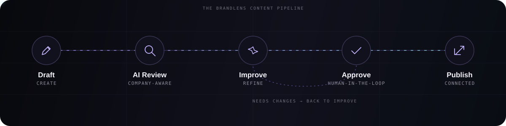
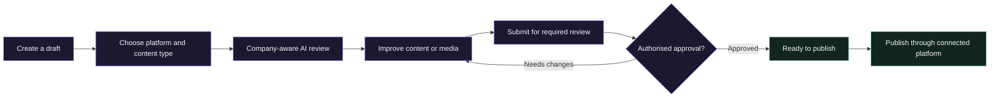
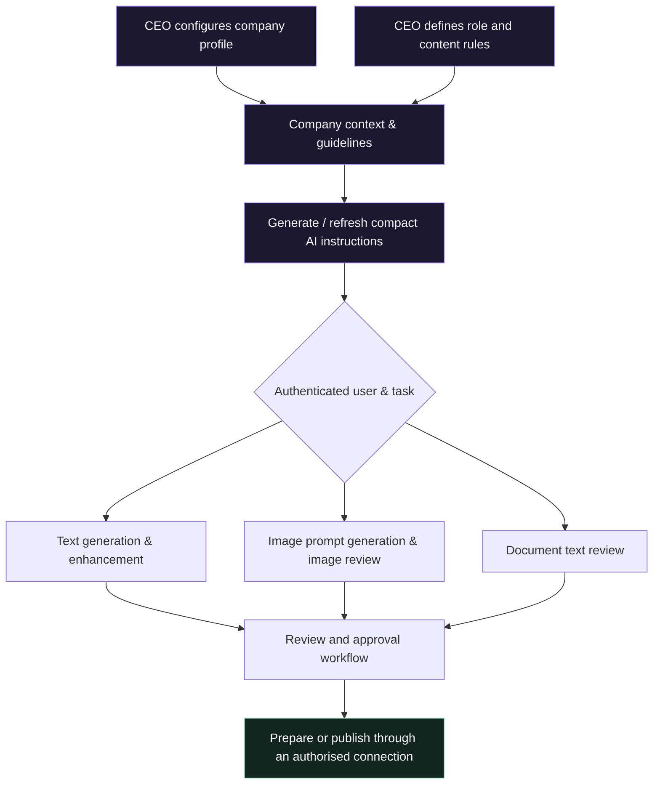

<div align="center">


**AI-powered brand governance. Company-aware content creation. Connected publishing.**

<p>
  <a href="#-overview">Overview</a> &nbsp;·&nbsp;
  <a href="#-platform-capabilities">Capabilities</a> &nbsp;·&nbsp;
  <a href="#-how-it-works">How it works</a> &nbsp;·&nbsp;
  <a href="#-workspaces--roles">Roles</a> &nbsp;·&nbsp;
  <a href="#-getting-started">Get started</a> &nbsp;·&nbsp;
  <a href="#-faq">FAQ</a>
</p>

<p>
  
  
  
  
</p>


<p>
  <a href="https://github.com/danger1818uu/BrandLens-Final/stargazers"></a>
  <a href="https://github.com/danger1818uu/BrandLens-Final/commits"></a>
  <a href="https://github.com/danger1818uu/BrandLens-Final/issues"></a>
  <a href="LICENSE"></a>
</p>

</div>


## ✨ Overview

**BrandLens** is an AI-powered brand operations platform that helps organisations create, review, improve, manage, and publish content while staying aligned with their own identity and rules.

Instead of treating every post as a standalone piece of writing, BrandLens considers the bigger picture:

> **Which company** is publishing · **who** is creating the content · **what** the organisation allows · **which audience** it targets · **where** it will appear.

From company setup and team management to AI-assisted content workflows and connected social publishing, BrandLens brings essential brand operations into one workspace.

<div align="center">
  <h3>One workspace. Every team. One consistent brand.</h3>
  <sub><b>Review with context</b> &nbsp;•&nbsp; <b>Create with clarity</b> &nbsp;•&nbsp; <b>Publish with control</b></sub>
</div>

<br />

<div align="center">
<table>
  <tr>
    <td align="center"><h3>🏢<br/>Multi-company</h3><sub>Isolated workspaces per organisation</sub></td>
    <td align="center"><h3>🧭<br/>Role-based</h3><sub>CEO · Admin · HOD · Manager · Employee</sub></td>
    <td align="center"><h3>🧠<br/>Company-aware AI</h3><sub>Your voice, your rules, your facts</sub></td>
    <td align="center"><h3>📣<br/>Connected</h3><sub>Approve, then publish with control</sub></td>
  </tr>
</table>
</div>


## 🚀 Platform capabilities

<table>
  <tr>
    <td width="50%" valign="top">
      <h3>🏢 Multi-company workspaces</h3>
      Each organisation gets its own workspace, company profile, team, permissions, content, and guidelines. Company data stays separated by organisation.
    </td>
    <td width="50%" valign="top">
      <h3>🧭 Role-based management</h3>
      Dedicated experiences for CEOs, administrators, HODs, managers, and employees, with responsibilities and access based on assigned roles.
    </td>
  </tr>
  <tr>
    <td width="50%" valign="top">
      <h3>🧠 Company-aware AI</h3>
      AI workflows use the organisation's saved business context, brand voice, approved information, and relevant role and content guidelines.
    </td>
    <td width="50%" valign="top">
      <h3>📣 Social content &amp; publishing</h3>
      Create and review content for supported social channels, manage approvals, and publish through configured and authorised platform connections.
    </td>
  </tr>
  <tr>
    <td width="50%" valign="top">
      <h3>💬 Team messaging &amp; support</h3>
      Built-in messaging and a WhatsApp support/help assistant keep team communication and support access close to the workflow.
    </td>
    <td width="50%" valign="top">
      <h3>🪄 Content Enhancer</h3>
      Text review, text enhancement, image review, image generation, and PDF/DOCX text extraction in one focused workspace.
    </td>
  </tr>
</table>


## 🔭 How it works

### The content pipeline

<div align="center">
  
</div>

<br />

BrandLens keeps creation and review connected, so teams can work with drafts, feedback, pending items, history, and publishing status in one place.

<details>
<summary><b>View the detailed workflow diagram</b></summary>



</details>

### AI that adapts to the organisation

A company's AI experience should reflect that company's own identity, not a generic prompt shared by every customer.

When a CEO configures **About Company** and **Guidelines**, BrandLens uses the saved information to prepare concise, task-specific AI instructions. Relevant instructions are then used by the supported AI workflows.



> [!NOTE]
> **The result:** a technology company can use its hosting-related context and rules, while a beauty, education, services, or other organisation uses its own saved information and guidelines. Instructions are selected for the relevant company, role, task, and supported platform.


## 👥 Workspaces & roles

| Role | What it manages |
|---|---|
| 👑 **CEO** | Company profile, organisation-wide guidelines, role-specific rules, team accounts, and company configuration. |
| 🛡️ **Administrator** | Platform and organisation administration according to assigned permissions. |
| 🏛️ **HOD** | Department-level responsibilities, specialist review, and relevant content workflows. |
| 🧑‍💼 **Manager** | Team content review, feedback, approvals, and assigned publishing responsibilities. |
| ✍️ **Employee** | Drafting, enhancing, submitting, and tracking content within assigned permissions. |

Access is role-based. The exact actions available to each user depend on the permissions and workflow configured for that organisation.

## 🪄 Content creation & Enhancer

| Tool | Purpose |
|---|---|
| **Text Generation** | Create platform-aware content using the company's saved context and applicable guidelines. |
| **Text Review** | Check a draft for clarity, relevance, tone, and guideline alignment. |
| **Text Enhancement** | Improve wording while preserving the intended message and respecting approved company information. |
| **Image Generation** | Prepare a concise visual prompt from the post request and relevant company context, then use the configured image-generation service. |
| **Image Review** | Review submitted visual content using the checks supported by the configured image-review service. |
| **PDF/DOCX Text Extract** | Extract text from supported documents for further review or reuse. |

## 💬 Messaging & support

- **Team messaging** for communication within the workspace, subject to configured access.
- **WhatsApp support/help assistant** as an additional support channel.
- **Help resources** to guide users through platform workflows and common questions.

## 🏷️ Example workspace: Nova Unlimited

The Nova Unlimited workspace demonstrates how company context can guide content decisions. A server/hosting-focused organisation can define its own approved service descriptions, technical communication style, and rules for claims that require verification.

> [!TIP]
> Nova Unlimited is an example, not a universal configuration. Every company receives its own profile, team, guidelines, and AI instructions.


## 🛡️ Designed around control and accountability

BrandLens assists teams; it does not remove human responsibility.

| Principle | In practice |
|---|---|
| 🧑‍⚖️ **Human decision-making** | AI output and review findings should be checked by the people authorised to decide. |
| 🔐 **Permissioned publishing** | External publishing depends on the platform connection, permissions, and successful confirmation from that platform. |
| 🏢 **Data separation** | Company data is kept separate by organisation. |
| 🔑 **Secrets stay server-side** | API keys, OAuth secrets, tokens, and database credentials are never exposed to the client. |

> [!IMPORTANT]
> Configure access, approved facts, and review rules carefully before using BrandLens with sensitive or confidential business information.

## 🧰 Getting started

1. **Clone** or download this repository.
2. **Install** dependencies using the package manager and instructions already defined by the project.
3. **Configure** the required server-side environment variables for the database, AI services, messaging/support integrations, and authorised social-platform connections.
4. **Start** the application using the scripts provided by the project.
5. **Create** a company workspace, configure its profile and guidelines, and invite users with the appropriate roles.

```bash
git clone https://github.com/danger1818uu/BrandLens-Final.git
cd BrandLens-Final
# install & run using the project's own scripts
```

> [!WARNING]
> Keep API keys, OAuth secrets, access tokens, and database credentials server-side. Never commit real secrets or customer credentials to the repository.

<details>
<summary><b>📁 Repository structure</b></summary>

```text
BrandLens-Final/
├── assets/
│   ├── brandlens-banner.svg   # animated hero banner
│   ├── tagline.svg            # rotating tagline
│   ├── workflow.svg           # animated content pipeline
│   └── divider.svg            # animated section divider
├── README.md
└── ... application source files
```

The application source structure may differ depending on the current project layout.

</details>

## ❓ FAQ

<details>
<summary><b>Is company data shared between organisations?</b></summary>
<br />
No. Each organisation has its own workspace, profile, team, permissions, content, and guidelines.
</details>

<details>
<summary><b>Does AI publish content on its own?</b></summary>
<br />
No. Content follows the configured review and approval workflow, and publishing requires an authorised platform connection.
</details>

<details>
<summary><b>Can different companies have different AI behaviour?</b></summary>
<br />
Yes. AI instructions are generated from each company's own About Company details and guidelines, then selected by role, task, and platform.
</details>

<details>
<summary><b>Which external integrations are available?</b></summary>
<br />
Availability depends on your deployment configuration and valid provider permissions.
</details>

## 📌 Project status

BrandLens brings together multi-company management, role-based workspaces, company-aware AI content workflows, team communication, support, and connected publishing. Availability of external integrations depends on the deployment configuration and valid provider permissions.

<br />


<div align="center">
  <h2>Make every impression count.</h2>
  <p><strong>BrandLens</strong> — Clarity in every impression.</p>
  <sub>Built for clarity. Designed for trust.</sub>
  <br /><br />
  <a href="#-overview">Back to top ↑</a>
</div>
